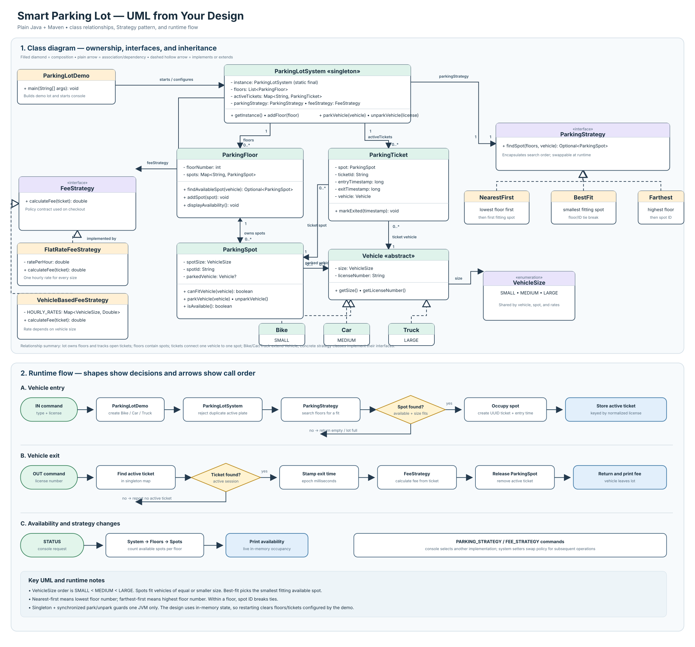

# Parking Lot System — Plain Java Maven

This is a standalone Java implementation of the attached UML design for a multi-floor parking lot. It uses Maven to compile and run the code, but has **no Spring/Spring Boot dependencies** and no external runtime libraries.

## Requirements

- JDK 21
- Maven 3.9+

## Run

```bash
mvn clean package
java -cp target/classes com.mayur.parking.controller.ParkingLotDemo
```

The console accepts:

```text
IN CAR ABC-123
OUT ABC-123
PARKING_STRATEGY BEST_FIT
FEE_STRATEGY VEHICLE
STATUS
QUIT
```

## Design, UML, and workflow

See [WORKFLOW.md](docs/WORKFLOW.md) for class responsibilities, strategy semantics, entry/exit flow, and implementation scope.

[Open the complete UML diagram as SVG](docs/ParkingLotSystem_UML.svg).


